# 口播剪辑 Skill 合集（60 套）

把真人口播包装成不同视觉风格的短视频：每个 skill 自带渲染引擎、字体与控件，产出**可编辑的剪映草稿**（动效层、人物、口播、字幕分轨），也可直接导出 MP4。适用于 Claude Code / Codex 等支持 `SKILL.md` 的宿主。

下面每张动图都是该 skill 用同一段 19.3 秒样板口播真跑出来的（点图看完整视频）。样板里的主播是程序绘制的无五官人形、声音是合成配音，不含任何真人。按风格分 8 类：[科技暗场](#科技暗场)（8） · [纸面手作](#纸面手作)（10） · [编辑网格](#编辑网格)（7） · [海报印刷](#海报印刷)（6） · [角色舞台](#角色舞台)（6） · [场景拟物](#场景拟物)（6） · [影像艺术](#影像艺术)（5） · [行业专题](#行业专题)（12）

### 科技暗场

深色底 + 等宽字 / HUD / 发光，适合科技、AI、数据、产品发布

<table>
<tr><td align="center" valign="top" width="33%"><a href="skills/02-tech-console-koubo/assets/sample.mp4">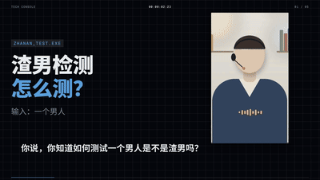</a><br><b>02 · 控制台 · 横屏版</b><br><sub>1920×1080 · 暗底 · <a href="skills/02-tech-console-koubo">skill</a> · <a href="skills/02-tech-console-koubo/assets/sample.mp4">▶ 视频</a></sub></td><td align="center" valign="top" width="33%"><a href="skills/10-tech-console-portrait-koubo/assets/sample.mp4">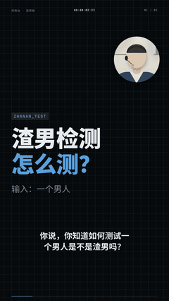</a><br><b>10 · 控制台 · 竖屏版</b><br><sub>1080×1920 · 暗底 · <a href="skills/10-tech-console-portrait-koubo">skill</a> · <a href="skills/10-tech-console-portrait-koubo/assets/sample.mp4">▶ 视频</a></sub></td><td align="center" valign="top" width="33%"><a href="skills/04-kinetic-tech-koubo/assets/sample.mp4">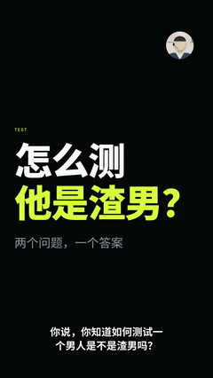</a><br><b>04 · 动态技术 · 竖屏版</b><br><sub>1080×1920 · 暗底 · <a href="skills/04-kinetic-tech-koubo">skill</a> · <a href="skills/04-kinetic-tech-koubo/assets/sample.mp4">▶ 视频</a></sub></td></tr>
<tr><td align="center" valign="top" width="33%"><a href="skills/09-dark-dimensional-stage-koubo/assets/sample.mp4">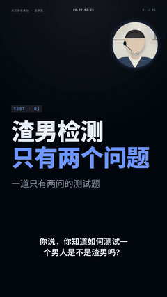</a><br><b>09 · 深空多维舞台 · 竖屏版</b><br><sub>1080×1920 · 暗底 · <a href="skills/09-dark-dimensional-stage-koubo">skill</a> · <a href="skills/09-dark-dimensional-stage-koubo/assets/sample.mp4">▶ 视频</a></sub></td><td align="center" valign="top" width="33%"><a href="skills/13-dark-dimensional-stage-wide-koubo/assets/sample.mp4">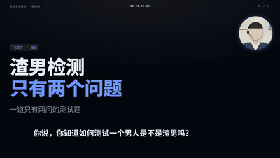</a><br><b>13 · 深空多维舞台 · 横屏版</b><br><sub>1920×1080 · 暗底 · <a href="skills/13-dark-dimensional-stage-wide-koubo">skill</a> · <a href="skills/13-dark-dimensional-stage-wide-koubo/assets/sample.mp4">▶ 视频</a></sub></td><td align="center" valign="top" width="33%"><a href="skills/33-screen-collage-koubo/assets/sample.mp4">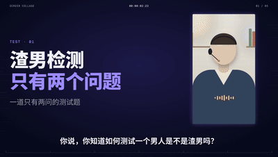</a><br><b>33 · 屏幕拼贴 · 品牌故事</b><br><sub>1920×1080 · 暗底 · <a href="skills/33-screen-collage-koubo">skill</a> · <a href="skills/33-screen-collage-koubo/assets/sample.mp4">▶ 视频</a></sub></td></tr>
<tr><td align="center" valign="top" width="33%"><a href="skills/38-engineering-blueprint-koubo/assets/sample.mp4">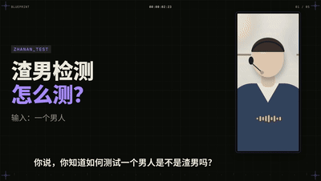</a><br><b>38 · 工程蓝图 · 产品拆解</b><br><sub>1920×1080 · 暗底 · <a href="skills/38-engineering-blueprint-koubo">skill</a> · <a href="skills/38-engineering-blueprint-koubo/assets/sample.mp4">▶ 视频</a></sub></td><td align="center" valign="top" width="33%"><a href="skills/45-glowing-lightboard-koubo/assets/sample.mp4">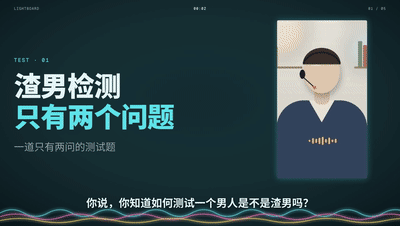</a><br><b>45 · 发光灯板 · 知识讲解</b><br><sub>1920×1080 · 暗底 · <a href="skills/45-glowing-lightboard-koubo">skill</a> · <a href="skills/45-glowing-lightboard-koubo/assets/sample.mp4">▶ 视频</a></sub></td></tr>
</table>

### 纸面手作

纸张、笔记、黑板、剪纸、黏土、油画，适合知识讲解与温和叙事

<table>
<tr><td align="center" valign="top" width="33%"><a href="skills/01-paper-perspective-koubo/assets/sample.mp4">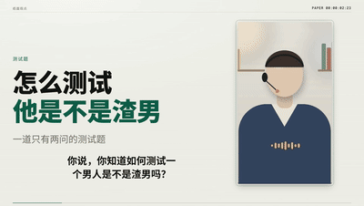</a><br><b>01 · 纸面观点 · 横屏版</b><br><sub>1920×1080 · 亮底 · <a href="skills/01-paper-perspective-koubo">skill</a> · <a href="skills/01-paper-perspective-koubo/assets/sample.mp4">▶ 视频</a></sub></td><td align="center" valign="top" width="33%"><a href="skills/08-paper-perspective-portrait-koubo/assets/sample.mp4">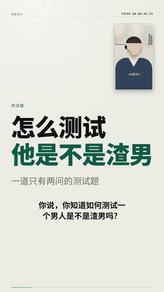</a><br><b>08 · 纸面观点 · 竖屏版</b><br><sub>1080×1920 · 亮底 · <a href="skills/08-paper-perspective-portrait-koubo">skill</a> · <a href="skills/08-paper-perspective-portrait-koubo/assets/sample.mp4">▶ 视频</a></sub></td><td align="center" valign="top" width="33%"><a href="skills/14-hand-drawn-cartoon-koubo/assets/sample.mp4">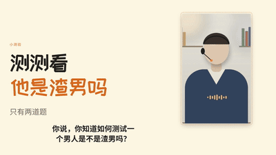</a><br><b>14 · 手绘卡通 · 横屏版</b><br><sub>1920×1080 · 亮底 · <a href="skills/14-hand-drawn-cartoon-koubo">skill</a> · <a href="skills/14-hand-drawn-cartoon-koubo/assets/sample.mp4">▶ 视频</a></sub></td></tr>
<tr><td align="center" valign="top" width="33%"><a href="skills/34-paper-scroll-koubo/assets/sample.mp4">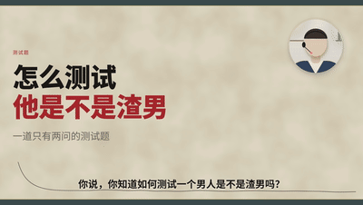</a><br><b>34 · 长卷 · 品牌故事</b><br><sub>1920×1080 · 亮底 · <a href="skills/34-paper-scroll-koubo">skill</a> · <a href="skills/34-paper-scroll-koubo/assets/sample.mp4">▶ 视频</a></sub></td><td align="center" valign="top" width="33%"><a href="skills/41-dot-grid-notes-koubo/assets/sample.mp4">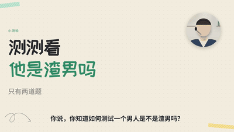</a><br><b>41 · 点阵笔记 · 知识讲解</b><br><sub>1920×1080 · 亮底 · <a href="skills/41-dot-grid-notes-koubo">skill</a> · <a href="skills/41-dot-grid-notes-koubo/assets/sample.mp4">▶ 视频</a></sub></td><td align="center" valign="top" width="33%"><a href="skills/42-chalkboard-koubo/assets/sample.mp4">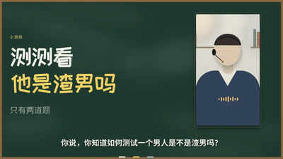</a><br><b>42 · 黑板 · 知识讲解</b><br><sub>1920×1080 · 暗底 · <a href="skills/42-chalkboard-koubo">skill</a> · <a href="skills/42-chalkboard-koubo/assets/sample.mp4">▶ 视频</a></sub></td></tr>
<tr><td align="center" valign="top" width="33%"><a href="skills/46-growing-mind-map-koubo/assets/sample.mp4">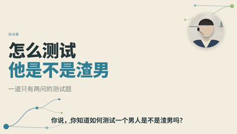</a><br><b>46 · 生长导图 · 知识讲解</b><br><sub>1920×1080 · 亮底 · <a href="skills/46-growing-mind-map-koubo">skill</a> · <a href="skills/46-growing-mind-map-koubo/assets/sample.mp4">▶ 视频</a></sub></td><td align="center" valign="top" width="33%"><a href="skills/50-layered-papercut-koubo/assets/sample.mp4"></a><br><b>50 · 叠层剪纸 · 知识讲解</b><br><sub>1920×1080 · 暗底 · <a href="skills/50-layered-papercut-koubo">skill</a> · <a href="skills/50-layered-papercut-koubo/assets/sample.mp4">▶ 视频</a></sub></td><td align="center" valign="top" width="33%"><a href="skills/52-clay-lab-koubo/assets/sample.mp4"></a><br><b>52 · 黏土实验室 · 知识讲解</b><br><sub>1920×1080 · 亮底 · <a href="skills/52-clay-lab-koubo">skill</a> · <a href="skills/52-clay-lab-koubo/assets/sample.mp4">▶ 视频</a></sub></td></tr>
<tr><td align="center" valign="top" width="33%"><a href="skills/58-brush-repainting-koubo/assets/sample.mp4">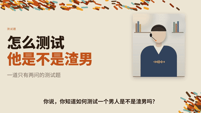</a><br><b>58 · 笔触重绘 · 艺术照片</b><br><sub>1920×1080 · 亮底 · <a href="skills/58-brush-repainting-koubo">skill</a> · <a href="skills/58-brush-repainting-koubo/assets/sample.mp4">▶ 视频</a></sub></td></tr>
</table>

### 编辑网格

杂志版式、留白、网格与单一强调色，适合观点、评论、教程

<table>
<tr><td align="center" valign="top" width="33%"><a href="skills/03-modern-editorial-koubo/assets/sample.mp4">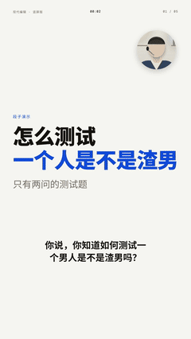</a><br><b>03 · 现代编辑 · 竖屏版</b><br><sub>1080×1920 · 亮底 · <a href="skills/03-modern-editorial-koubo">skill</a> · <a href="skills/03-modern-editorial-koubo/assets/sample.mp4">▶ 视频</a></sub></td><td align="center" valign="top" width="33%"><a href="skills/07-modern-editorial-wide-koubo/assets/sample.mp4">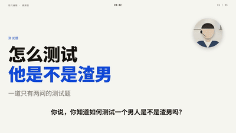</a><br><b>07 · 现代编辑 · 横屏版</b><br><sub>1920×1080 · 亮底 · <a href="skills/07-modern-editorial-wide-koubo">skill</a> · <a href="skills/07-modern-editorial-wide-koubo/assets/sample.mp4">▶ 视频</a></sub></td><td align="center" valign="top" width="33%"><a href="skills/17-beyond-the-frame-koubo/assets/sample.mp4">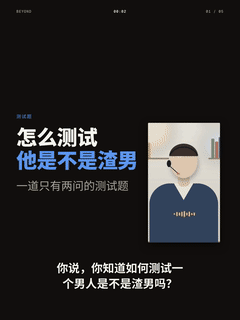</a><br><b>17 · 越界 · 3:4</b><br><sub>1440×1920 · 亮底 · <a href="skills/17-beyond-the-frame-koubo">skill</a> · <a href="skills/17-beyond-the-frame-koubo/assets/sample.mp4">▶ 视频</a></sub></td></tr>
<tr><td align="center" valign="top" width="33%"><a href="skills/35-light-dark-cuts-koubo/assets/sample.mp4">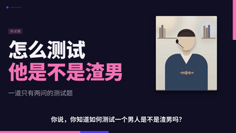</a><br><b>35 · 明暗切 · 产品宣传</b><br><sub>1920×1080 · 暗底 · <a href="skills/35-light-dark-cuts-koubo">skill</a> · <a href="skills/35-light-dark-cuts-koubo/assets/sample.mp4">▶ 视频</a></sub></td><td align="center" valign="top" width="33%"><a href="skills/37-workflow-demo-koubo/assets/sample.mp4">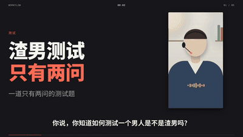</a><br><b>37 · 流程演示 · 产品教程</b><br><sub>1920×1080 · 亮底 · <a href="skills/37-workflow-demo-koubo">skill</a> · <a href="skills/37-workflow-demo-koubo/assets/sample.mp4">▶ 视频</a></sub></td><td align="center" valign="top" width="33%"><a href="skills/43-swiss-grid-koubo/assets/sample.mp4">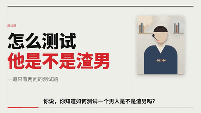</a><br><b>43 · 瑞士网格 · 知识讲解</b><br><sub>1920×1080 · 亮底 · <a href="skills/43-swiss-grid-koubo">skill</a> · <a href="skills/43-swiss-grid-koubo/assets/sample.mp4">▶ 视频</a></sub></td></tr>
<tr><td align="center" valign="top" width="33%"><a href="skills/57-double-exposure-koubo/assets/sample.mp4">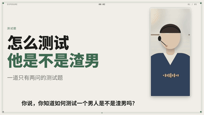</a><br><b>57 · 双重曝光 · 人像叠影</b><br><sub>1920×1080 · 亮底 · <a href="skills/57-double-exposure-koubo">skill</a> · <a href="skills/57-double-exposure-koubo/assets/sample.mp4">▶ 视频</a></sub></td></tr>
</table>

### 海报印刷

大字号、色块、几何拼贴、孔版网点，适合态度表达与宣传

<table>
<tr><td align="center" valign="top" width="33%"><a href="skills/05-vibrant-poster-koubo/assets/sample.mp4">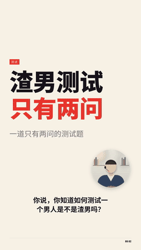</a><br><b>05 · 鲜活海报 · 竖屏版</b><br><sub>1080×1920 · 亮底 · <a href="skills/05-vibrant-poster-koubo">skill</a> · <a href="skills/05-vibrant-poster-koubo/assets/sample.mp4">▶ 视频</a></sub></td><td align="center" valign="top" width="33%"><a href="skills/11-vibrant-poster-wide-koubo/assets/sample.mp4">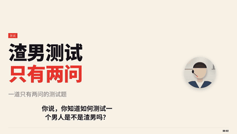</a><br><b>11 · 鲜活海报 · 横屏版</b><br><sub>1920×1080 · 亮底 · <a href="skills/11-vibrant-poster-wide-koubo">skill</a> · <a href="skills/11-vibrant-poster-wide-koubo/assets/sample.mp4">▶ 视频</a></sub></td><td align="center" valign="top" width="33%"><a href="skills/40-modular-collage-koubo/assets/sample.mp4">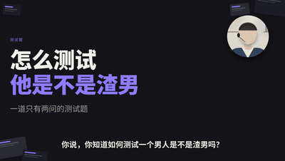</a><br><b>40 · 模块拼贴 · 创作者工具</b><br><sub>1920×1080 · 亮底 · <a href="skills/40-modular-collage-koubo">skill</a> · <a href="skills/40-modular-collage-koubo/assets/sample.mp4">▶ 视频</a></sub></td></tr>
<tr><td align="center" valign="top" width="33%"><a href="skills/44-color-geometry-koubo/assets/sample.mp4">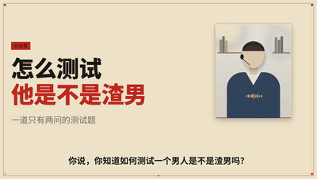</a><br><b>44 · 色块几何 · 知识讲解</b><br><sub>1920×1080 · 亮底 · <a href="skills/44-color-geometry-koubo">skill</a> · <a href="skills/44-color-geometry-koubo/assets/sample.mp4">▶ 视频</a></sub></td><td align="center" valign="top" width="33%"><a href="skills/48-two-color-risograph-koubo/assets/sample.mp4">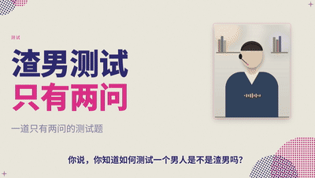</a><br><b>48 · 双色孔版 · 知识讲解</b><br><sub>1920×1080 · 亮底 · <a href="skills/48-two-color-risograph-koubo">skill</a> · <a href="skills/48-two-color-risograph-koubo/assets/sample.mp4">▶ 视频</a></sub></td><td align="center" valign="top" width="33%"><a href="skills/54-geometric-collage-koubo/assets/sample.mp4">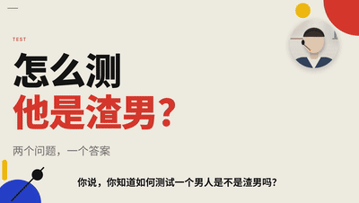</a><br><b>54 · 几何拼贴 · 动态海报</b><br><sub>1920×1080 · 亮底 · <a href="skills/54-geometric-collage-koubo">skill</a> · <a href="skills/54-geometric-collage-koubo/assets/sample.mp4">▶ 视频</a></sub></td></tr>
</table>

### 角色舞台

角色卡、剧场、发布会舞台、展厅，适合故事、人物与揭晓

<table>
<tr><td align="center" valign="top" width="33%"><a href="skills/06-vivid-characters-koubo/assets/sample.mp4">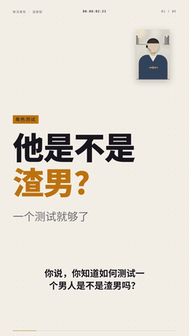</a><br><b>06 · 鲜活角色 · 竖屏版</b><br><sub>1080×1920 · 亮底 · <a href="skills/06-vivid-characters-koubo">skill</a> · <a href="skills/06-vivid-characters-koubo/assets/sample.mp4">▶ 视频</a></sub></td><td align="center" valign="top" width="33%"><a href="skills/12-vivid-characters-wide-koubo/assets/sample.mp4">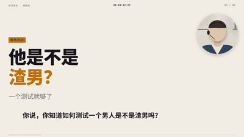</a><br><b>12 · 鲜活角色 · 横屏版</b><br><sub>1920×1080 · 亮底 · <a href="skills/12-vivid-characters-wide-koubo">skill</a> · <a href="skills/12-vivid-characters-wide-koubo/assets/sample.mp4">▶ 视频</a></sub></td><td align="center" valign="top" width="33%"><a href="skills/15-card-table-shuffle-koubo/assets/sample.mp4">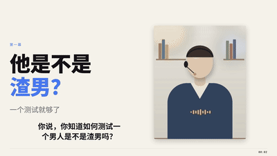</a><br><b>15 · 卡牌桌 · 横屏版</b><br><sub>1920×1080 · 亮底 · <a href="skills/15-card-table-shuffle-koubo">skill</a> · <a href="skills/15-card-table-shuffle-koubo/assets/sample.mp4">▶ 视频</a></sub></td></tr>
<tr><td align="center" valign="top" width="33%"><a href="skills/20-character-theater-koubo/assets/sample.mp4">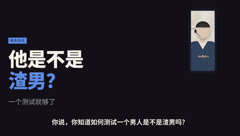</a><br><b>20 · 角色剧场 · 横屏版</b><br><sub>1920×1080 · 暗底 · <a href="skills/20-character-theater-koubo">skill</a> · <a href="skills/20-character-theater-koubo/assets/sample.mp4">▶ 视频</a></sub></td><td align="center" valign="top" width="33%"><a href="skills/39-keynote-stage-koubo/assets/sample.mp4">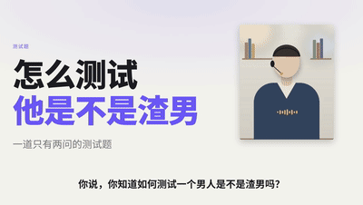</a><br><b>39 · 发布会舞台 · 产品演示</b><br><sub>1920×1080 · 亮底 · <a href="skills/39-keynote-stage-koubo">skill</a> · <a href="skills/39-keynote-stage-koubo/assets/sample.mp4">▶ 视频</a></sub></td><td align="center" valign="top" width="33%"><a href="skills/47-museum-timeline-koubo/assets/sample.mp4">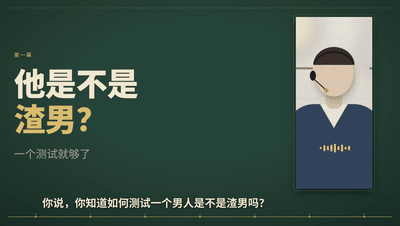</a><br><b>47 · 博物馆年表 · 知识讲解</b><br><sub>1920×1080 · 暗底 · <a href="skills/47-museum-timeline-koubo">skill</a> · <a href="skills/47-museum-timeline-koubo/assets/sample.mp4">▶ 视频</a></sub></td></tr>
</table>

### 场景拟物

取景器、桌面、新闻台、像素游戏、等距系统、地铁线网

<table>
<tr><td align="center" valign="top" width="33%"><a href="skills/16-camera-mode-koubo/assets/sample.mp4">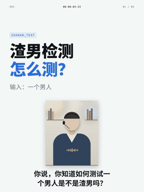</a><br><b>16 · 取景器 · 3:4</b><br><sub>1080×1440 · 亮底 · <a href="skills/16-camera-mode-koubo">skill</a> · <a href="skills/16-camera-mode-koubo/assets/sample.mp4">▶ 视频</a></sub></td><td align="center" valign="top" width="33%"><a href="skills/18-mac-desktop-koubo/assets/sample.mp4">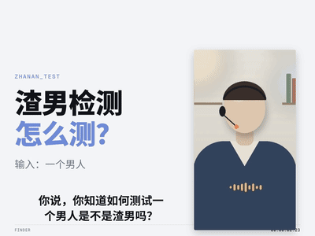</a><br><b>18 · 桌面 · 4:3</b><br><sub>1440×1080 · 亮底 · <a href="skills/18-mac-desktop-koubo">skill</a> · <a href="skills/18-mac-desktop-koubo/assets/sample.mp4">▶ 视频</a></sub></td><td align="center" valign="top" width="33%"><a href="skills/19-news-desk-koubo/assets/sample.mp4">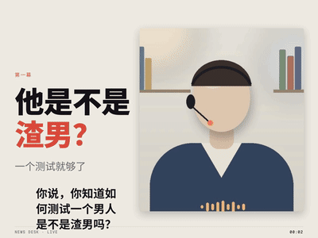</a><br><b>19 · 新闻台 · 4:3</b><br><sub>1440×1080 · 暗底 · <a href="skills/19-news-desk-koubo">skill</a> · <a href="skills/19-news-desk-koubo/assets/sample.mp4">▶ 视频</a></sub></td></tr>
<tr><td align="center" valign="top" width="33%"><a href="skills/36-pixel-platformer-koubo/assets/sample.mp4">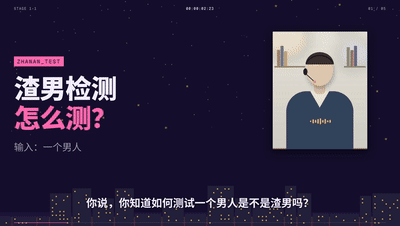</a><br><b>36 · 像素闯关 · 产品介绍</b><br><sub>1920×1080 · 暗底 · <a href="skills/36-pixel-platformer-koubo">skill</a> · <a href="skills/36-pixel-platformer-koubo/assets/sample.mp4">▶ 视频</a></sub></td><td align="center" valign="top" width="33%"><a href="skills/49-isometric-systems-koubo/assets/sample.mp4">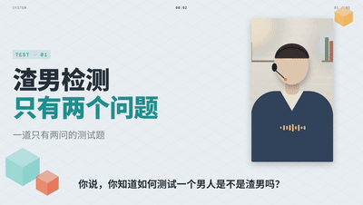</a><br><b>49 · 等距系统 · 知识讲解</b><br><sub>1920×1080 · 亮底 · <a href="skills/49-isometric-systems-koubo">skill</a> · <a href="skills/49-isometric-systems-koubo/assets/sample.mp4">▶ 视频</a></sub></td><td align="center" valign="top" width="33%"><a href="skills/51-metro-network-koubo/assets/sample.mp4">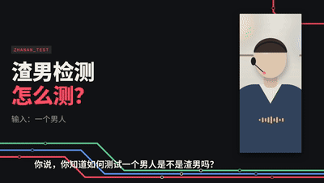</a><br><b>51 · 地铁线网 · 知识讲解</b><br><sub>1920×1080 · 亮底 · <a href="skills/51-metro-network-koubo">skill</a> · <a href="skills/51-metro-network-koubo/assets/sample.mp4">▶ 视频</a></sub></td></tr>
</table>

### 影像艺术

半调、画廊、马赛克、故障、万花筒，适合照片、回忆与情绪片

<table>
<tr><td align="center" valign="top" width="33%"><a href="skills/53-halftone-dots-koubo/assets/sample.mp4">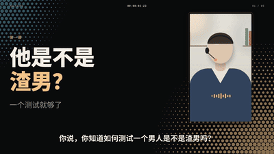</a><br><b>53 · 半调网点 · 人像标题</b><br><sub>1920×1080 · 暗底 · <a href="skills/53-halftone-dots-koubo">skill</a> · <a href="skills/53-halftone-dots-koubo/assets/sample.mp4">▶ 视频</a></sub></td><td align="center" valign="top" width="33%"><a href="skills/55-spatial-gallery-koubo/assets/sample.mp4">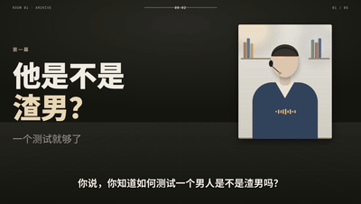</a><br><b>55 · 空间画廊 · 照片回忆</b><br><sub>1920×1080 · 暗底 · <a href="skills/55-spatial-gallery-koubo">skill</a> · <a href="skills/55-spatial-gallery-koubo/assets/sample.mp4">▶ 视频</a></sub></td><td align="center" valign="top" width="33%"><a href="skills/56-photo-mosaic-koubo/assets/sample.mp4">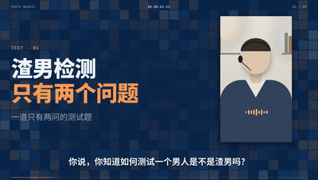</a><br><b>56 · 照片马赛克 · 画面揭晓</b><br><sub>1920×1080 · 暗底 · <a href="skills/56-photo-mosaic-koubo">skill</a> · <a href="skills/56-photo-mosaic-koubo/assets/sample.mp4">▶ 视频</a></sub></td></tr>
<tr><td align="center" valign="top" width="33%"><a href="skills/59-signal-glitch-koubo/assets/sample.mp4">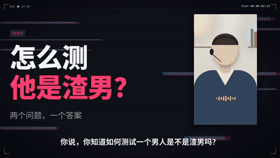</a><br><b>59 · 信号故障 · 照片转场</b><br><sub>1920×1080 · 暗底 · <a href="skills/59-signal-glitch-koubo">skill</a> · <a href="skills/59-signal-glitch-koubo/assets/sample.mp4">▶ 视频</a></sub></td><td align="center" valign="top" width="33%"><a href="skills/60-mirror-kaleidoscope-koubo/assets/sample.mp4">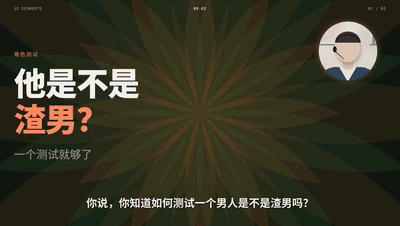</a><br><b>60 · 镜像万花筒 · 照片律动</b><br><sub>1920×1080 · 亮底 · <a href="skills/60-mirror-kaleidoscope-koubo">skill</a> · <a href="skills/60-mirror-kaleidoscope-koubo/assets/sample.mp4">▶ 视频</a></sub></td></tr>
</table>

### 行业专题

竖屏 1080×1920，每个行业一条结构主轴（关系 / 工作 / 科技 / 汽车 / 吃喝 / 护肤 / 购物 / 教培 / 健康 / 法律 / 金融 / 房产）

<table>
<tr><td align="center" valign="top" width="33%"><a href="skills/21-industry-relationships-koubo/assets/sample.mp4">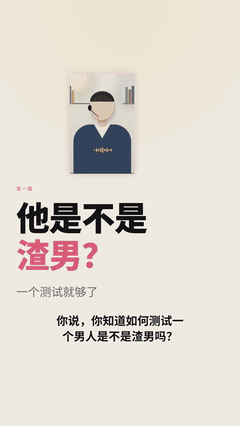</a><br><b>21 · 关系 · 一场对话复盘</b><br><sub>1080×1920 · 暗底 · <a href="skills/21-industry-relationships-koubo">skill</a> · <a href="skills/21-industry-relationships-koubo/assets/sample.mp4">▶ 视频</a></sub></td><td align="center" valign="top" width="33%"><a href="skills/22-industry-work-koubo/assets/sample.mp4">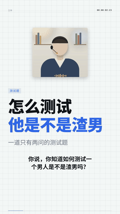</a><br><b>22 · 工作 · 三行周报</b><br><sub>1080×1920 · 亮底 · <a href="skills/22-industry-work-koubo">skill</a> · <a href="skills/22-industry-work-koubo/assets/sample.mp4">▶ 视频</a></sub></td><td align="center" valign="top" width="33%"><a href="skills/23-industry-tech-koubo/assets/sample.mp4">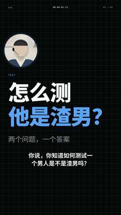</a><br><b>23 · 科技 · 换机还是再等等</b><br><sub>1080×1920 · 暗底 · <a href="skills/23-industry-tech-koubo">skill</a> · <a href="skills/23-industry-tech-koubo/assets/sample.mp4">▶ 视频</a></sub></td></tr>
<tr><td align="center" valign="top" width="33%"><a href="skills/24-industry-cars-koubo/assets/sample.mp4">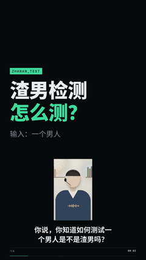</a><br><b>24 · 汽车 · 四项持有成本</b><br><sub>1080×1920 · 暗底 · <a href="skills/24-industry-cars-koubo">skill</a> · <a href="skills/24-industry-cars-koubo/assets/sample.mp4">▶ 视频</a></sub></td><td align="center" valign="top" width="33%"><a href="skills/25-industry-food-koubo/assets/sample.mp4"></a><br><b>25 · 吃喝 · 值不值得等</b><br><sub>1080×1920 · 暗底 · <a href="skills/25-industry-food-koubo">skill</a> · <a href="skills/25-industry-food-koubo/assets/sample.mp4">▶ 视频</a></sub></td><td align="center" valign="top" width="33%"><a href="skills/26-industry-skincare-koubo/assets/sample.mp4"></a><br><b>26 · 护肤 · 看懂成分表</b><br><sub>1080×1920 · 亮底 · <a href="skills/26-industry-skincare-koubo">skill</a> · <a href="skills/26-industry-skincare-koubo/assets/sample.mp4">▶ 视频</a></sub></td></tr>
<tr><td align="center" valign="top" width="33%"><a href="skills/27-industry-shopping-koubo/assets/sample.mp4"></a><br><b>27 · 购物 · 四个测试场景</b><br><sub>1080×1920 · 暗底 · <a href="skills/27-industry-shopping-koubo">skill</a> · <a href="skills/27-industry-shopping-koubo/assets/sample.mp4">▶ 视频</a></sub></td><td align="center" valign="top" width="33%"><a href="skills/28-industry-education-koubo/assets/sample.mp4"></a><br><b>28 · 教培 · 三套方案</b><br><sub>1080×1920 · 亮底 · <a href="skills/28-industry-education-koubo">skill</a> · <a href="skills/28-industry-education-koubo/assets/sample.mp4">▶ 视频</a></sub></td><td align="center" valign="top" width="33%"><a href="skills/29-industry-health-koubo/assets/sample.mp4"></a><br><b>29 · 健康 · 读懂化验单</b><br><sub>1080×1920 · 暗底 · <a href="skills/29-industry-health-koubo">skill</a> · <a href="skills/29-industry-health-koubo/assets/sample.mp4">▶ 视频</a></sub></td></tr>
<tr><td align="center" valign="top" width="33%"><a href="skills/30-industry-law-koubo/assets/sample.mp4"></a><br><b>30 · 法律 · 讨薪步骤</b><br><sub>1080×1920 · 亮底 · <a href="skills/30-industry-law-koubo">skill</a> · <a href="skills/30-industry-law-koubo/assets/sample.mp4">▶ 视频</a></sub></td><td align="center" valign="top" width="33%"><a href="skills/31-industry-finance-koubo/assets/sample.mp4"></a><br><b>31 · 金融 · 三本账</b><br><sub>1080×1920 · 亮底 · <a href="skills/31-industry-finance-koubo">skill</a> · <a href="skills/31-industry-finance-koubo/assets/sample.mp4">▶ 视频</a></sub></td><td align="center" valign="top" width="33%"><a href="skills/32-industry-realestate-koubo/assets/sample.mp4"></a><br><b>32 · 房产 · 一镜带看</b><br><sub>1080×1920 · 暗底 · <a href="skills/32-industry-realestate-koubo">skill</a> · <a href="skills/32-industry-realestate-koubo/assets/sample.mp4">▶ 视频</a></sub></td></tr>
</table>

## 安装（每个 skill 独立）

```sh
# 1. 把需要的 skill 目录复制到 ~/.claude/skills/
# 2. 安装渲染依赖（Playwright Chromium）
cd <skill>/scripts/engine && npm ci
# 3. 补齐大字体（Noto Sans SC，17.7 MB；从 google/fonts 固定提交下载并校验 sha256；支持代理，可用 KB_FONT_CACHE 指定本地缓存）
cd ../.. && node scripts/setup_light.mjs
```

需要：macOS（人物适配用 Vision 人脸检测）、Node 18+、Python 3.10+、ffmpeg。

## 工作流（每个 skill 的 SKILL.md 有详细说明）

1. 转写口播并人工核对字幕 → `cues.json`
2. `python3 scripts/person_fit.py 口播.mp4 --out presenter-fit.json`：按素材里的人物算人物框裁切（必要时加高人物框）
3. **按口播逐句**写镜头表（提问 → 方法 → 结论 → 揭晓），见 `examples/shots-控件演示.json`
4. `node scripts/engine/render.mjs build …` → `audit`（像素级版面审计：越界/压字/压人物/字号过小即报错）→ `render`
5. `python3 scripts/build_jianying_draft.py draft.json <新草稿目录>` → 登记进剪映（先退出剪映）

## 许可与来源

- 字体：Noto Sans SC、Geist Mono、站酷快乐体、Anton，均为 SIL OFL 1.1（许可文本在各 skill 的 `scripts/engine/stage/fonts/`）。
- `scripts/vendor/pyJianYingDraft`：Apache License 2.0（见 `scripts/vendor/LICENSE-pyJianYingDraft`）。
- 各风格的结构、比例、配色、节奏参考了公开的口播模板样片；本仓库**不包含**任何样片画面、人物、音乐、文案或品牌标识，渲染引擎与控件为原创实现。
- 示例口播文案为测试用段子，仅用于演示排版。

## 已知限制

- 剪映内打开/播放已人工抽验部分草稿；macOS 剪映的导出需在剪映里手动点击。
- 人物适配针对单人口播（多人时取画面中最大的人脸）。
